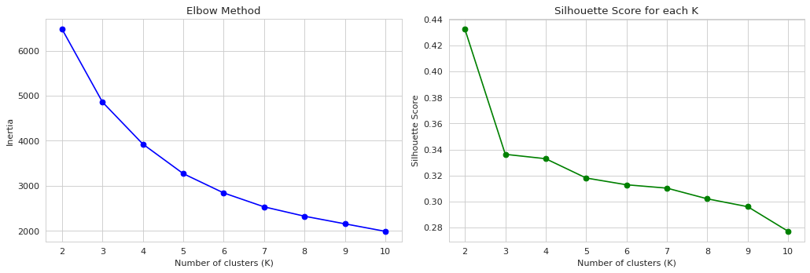
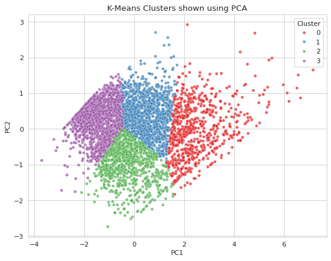
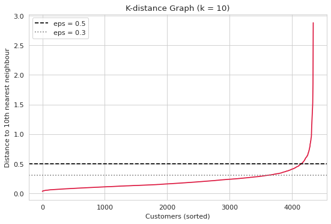
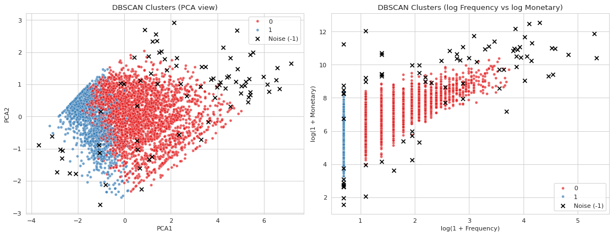
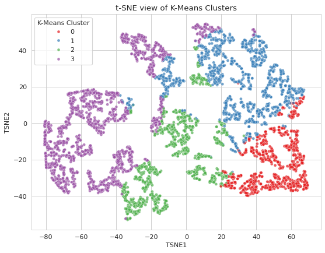
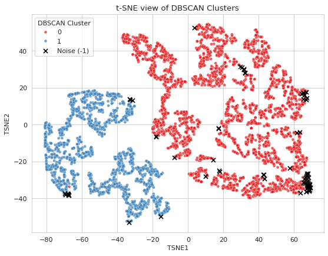
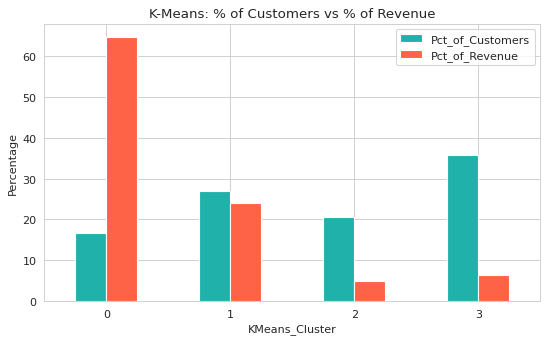

# E-Commerce Customer Segmentation using RFM Analysis, K-Means and DBSCAN

A beginner-friendly Machine Learning case study that groups online-shop customers by how they buy, so a business can send the right offer to the right customer.

## 1. Project Overview

An online retailer has thousands of customers, and not all of them are equally valuable. Some buy often and spend a lot, while others bought once and never returned. This project analyses real transaction data, describes every customer using **RFM** (Recency, Frequency, Monetary), groups similar customers with **K-Means** and **DBSCAN**, draws the groups using **PCA** and **t-SNE**, and finally converts each group into a **marketing persona** with a recommended action.

## 2. Project Objective

To segment e-commerce customers based on their purchasing behaviour and to suggest practical marketing actions for each customer segment.

## 3. Dataset

- **Name:** Online Retail dataset
- **Source:** UCI Machine Learning Repository - https://archive.ics.uci.edu/dataset/352/online+retail
- **Content:** transactions of a UK-based online retailer from 1 December 2010 to 9 December 2011
- **Size:** 541,909 rows and 8 columns

| Column | Meaning |
|---|---|
| InvoiceNo | Bill number (starts with `C` if the bill is a cancellation) |
| StockCode | Product code |
| Description | Product name |
| Quantity | Number of units bought |
| InvoiceDate | Date and time of purchase |
| UnitPrice | Price of one unit (in pounds) |
| CustomerID | Unique customer number |
| Country | Customer country |

> **The dataset file is not included in this repository.** Download `Online_Retail.xlsx` from the link above and place it in the `data/` folder (see [Installation](#15-installation-instructions)).

## 4. Technologies and Libraries Used

Python, pandas, NumPy, Matplotlib, Seaborn, scikit-learn (StandardScaler, KMeans, DBSCAN, PCA, TSNE, silhouette_score, NearestNeighbors), openpyxl (to read the Excel file) and Jupyter Notebook.

## 5. Six Main Topics Covered

1. **RFM Analysis** (Recency, Frequency, Monetary)
2. **K-Means Clustering**
3. **DBSCAN Clustering**
4. **PCA** (Principal Component Analysis)
5. **t-SNE** (t-Distributed Stochastic Neighbor Embedding)
6. **Actionable Marketing Personas** for every customer cluster

## 6. Project Workflow

1. Import libraries and load the dataset
2. Clean the data
3. Exploratory data analysis (EDA)
4. Calculate RFM for each customer
5. Log transformation and scaling
6. K-Means (choose K using the Elbow method and Silhouette Score)
7. PCA visualization
8. DBSCAN (choose eps using a K-distance graph)
9. t-SNE visualization
10. Cluster profiling using the original RFM values
11. Marketing personas
12. K-Means vs DBSCAN comparison, business insights and CSV export

## 7. Data Cleaning Steps

| Step | Why it is needed | Rows after the step |
|---|---|---|
| Start | - | 541,909 |
| Remove duplicate rows (5,268) | A repeated row would count one purchase twice | 536,641 |
| Remove rows with missing CustomerID | RFM is calculated per customer | 401,604 |
| Remove cancelled invoices (InvoiceNo starts with `C`) | They are not real purchases | 392,732 |
| Remove Quantity <= 0 or UnitPrice <= 0 | They are returns, free items or errors | 392,692 |

Then `InvoiceDate` was converted to datetime and `TotalAmount = Quantity x UnitPrice` was created.
**Final cleaned data: 392,692 rows, 4,338 customers, 18,532 invoices.**

## 8. RFM Analysis

- **Recency:** days between the customer's last purchase and the reference date (latest date + 1 day = 10 Dec 2011). Lower is better.
- **Frequency:** number of unique invoices. Higher is better.
- **Monetary:** total money spent. Higher is better.

Findings: the median customer last bought 51 days before the reference date, made 2 orders and spent about 669 pounds. The mean Monetary (about 2,049 pounds) is much higher than the median because a few customers spend a lot, and about 34% of customers placed only one order. Frequency and Monetary are strongly right-skewed (skewness 12.07 and 19.34), so `np.log1p()` and `StandardScaler` were applied before clustering. The original RFM values were kept for profiling.

## 9. K-Means and DBSCAN Methodology

**K-Means:** K = 2 to 10 was tested.

| K | 2 | 3 | 4 | 5 | 6 | 7 | 8 | 9 | 10 |
|---|---|---|---|---|---|---|---|---|---|
| Silhouette | 0.4325 | 0.3363 | 0.3329 | 0.3181 | 0.3129 | 0.3103 | 0.3021 | 0.2960 | 0.2771 |

K = 2 has the highest score but only separates active from inactive customers. K = 3 and K = 4 have almost the same score, and **K = 4 was selected** because it gives four groups that need different marketing actions. K = 3 would also be a defensible choice.

**DBSCAN:** `eps = 0.5` and `min_samples = 10`, chosen using the K-distance graph and a table of tested parameter combinations. DBSCAN found **2 clusters and 79 noise customers** (label -1). Its Silhouette Score (0.2946) was calculated **only on non-noise customers**, so it should not be compared directly with the K-Means score (0.3329, calculated on all customers).

## 10. PCA and t-SNE Visualizations

PCA and t-SNE are used **only to draw the clusters in 2D**. They are never used as input for clustering.

- **PCA:** PC1 explains 75.12% and PC2 explains 18.74% of the variance. Together they keep **93.86%** of the information.
- **t-SNE:** the 2D plots show the K-Means groups in mostly separate regions (lapsed customers mostly on the left, high-value customers mostly on the right) and the DBSCAN noise points at the high-value edge.

| Elbow and Silhouette | PCA (K-Means) |
|---|---|
|  |  |

| DBSCAN K-distance graph | DBSCAN clusters |
|---|---|
|  |  |

| t-SNE (K-Means) | t-SNE (DBSCAN) |
|---|---|
|  |  |



## 11. Customer Marketing Personas

| Cluster | Persona | Customers | % customers | % revenue | Median Recency (days) | Median Frequency | Median Monetary |
|---|---|---|---|---|---|---|---|
| 0 | Champions (High-Value Loyal) | 718 | 16.55% | 64.73% | 9 | 10 | 3,687.77 |
| 1 | Loyal Regulars (Cooling Down) | 1,174 | 27.06% | 24.08% | 52 | 4 | 1,355.04 |
| 2 | Recent / Promising New Customers | 897 | 20.68% | 4.91% | 20 | 2 | 414.20 |
| 3 | At-Risk / Lapsed Low-Value | 1,549 | 35.71% | 6.28% | 187 | 1 | 303.16 |

Recommended actions:
- **Champions:** VIP rewards, early access and personal contact. Protect them first.
- **Loyal Regulars:** re-order reminders around 30-45 days after the last order, loyalty points and bundles.
- **Recent / Promising New:** welcome emails and a time-limited offer to get a second or third order.
- **Lapsed Low-Value:** one or two low-cost win-back emails, then stop contacting non-responders.

**DBSCAN noise** (79 customers) is **not** treated as a normal persona. These customers need individual review.
The full persona text (behaviour, importance, strategy, action) is in `outputs/Customer_Marketing_Personas.csv`.

## 12. Important Business Insights (from the actual results)

- About **17% of customers (Cluster 0) generate about 65% of revenue**. The top 20% of all customers generate about 75%.
- The United Kingdom has 3,920 of the 4,338 customers and about 82% of revenue.
- November 2011 had the highest sales (about 1.16 million pounds), and sales rise from September to November. December 2011 is low only because the data stops on 9 December.
- About **34% of customers (1,493) bought only once**, so improving repeat purchases is a big opportunity.
- DBSCAN's 79 noise customers are 1.82% of customers but give **32.38% of revenue**, so they should be managed individually.

## 13. Folder Structure

```text
ecommerce-customer-segmentation/
├── ECommerce_Customer_Segmentation.ipynb   <- main notebook
├── outputs/                                <- 5 CSV files created by the notebook
│   ├── Ecommerce_Customer_Segmentation.csv
│   ├── KMeans_Cluster_Profile.csv
│   ├── DBSCAN_Cluster_Profile.csv
│   ├── Customer_Marketing_Personas.csv
│   └── Model_Comparison.csv
├── visualizations/                         <- graphs used in this README
├── data/                                   <- put Online_Retail.xlsx here (not uploaded to GitHub)
│   └── README.md
├── README.md
├── requirements.txt
└── .gitignore
```

## 14. Requirements

Python 3.10 or newer is recommended. The libraries are listed in `requirements.txt`.

## 15. Installation Instructions

```bash
# 1. Download the project
git clone https://github.com/YOUR_USERNAME/ecommerce-customer-segmentation.git
cd ecommerce-customer-segmentation

# 2. (Optional) create a virtual environment
python -m venv venv
venv\Scripts\activate          # Windows
source venv/bin/activate       # Mac / Linux

# 3. Install the libraries
pip install -r requirements.txt
```

Replace `YOUR_USERNAME` with the GitHub username of the repository owner.

**Dataset:** download `Online_Retail.xlsx` from https://archive.ics.uci.edu/dataset/352/online+retail and place it inside the `data/` folder.

## 16. How to Run the Notebook

**On your computer**

```bash
jupyter notebook
```

Open `ECommerce_Customer_Segmentation.ipynb` and choose **Run -> Run All Cells**. Reading the Excel file takes 1-2 minutes, and t-SNE takes about a minute.

**In Google Colab**

Upload the notebook, then upload `Online_Retail.xlsx` using the Files panel on the left (the notebook finds it in the main folder too), and run all cells. The CSV files are created in an `outputs` folder.

## 17. Output CSV Files

| File | Content |
|---|---|
| `Ecommerce_Customer_Segmentation.csv` | One row per customer (4,338 rows): CustomerID, Recency, Frequency, Monetary, K-Means cluster, DBSCAN cluster, K-Means persona, noise flag |
| `KMeans_Cluster_Profile.csv` | Size, average and median R, F, M, total revenue and percentages of each K-Means cluster |
| `DBSCAN_Cluster_Profile.csv` | The same summary for DBSCAN clusters, including noise (-1) |
| `Customer_Marketing_Personas.csv` | Persona name, behaviour, RFM values, importance, strategy and action for every cluster |
| `Model_Comparison.csv` | K-Means vs DBSCAN comparison |

## 18. Conclusion

RFM describes customer behaviour with three simple numbers. K-Means turned it into four clear and actionable customer groups, while DBSCAN found a small group of extreme customers who bring a large share of revenue. K-Means is more useful for marketing personas on this dataset, because the customers form one continuous cloud with no clear gaps, so DBSCAN can only separate repeat customers from one-time customers. PCA and t-SNE helped to visualise the results.

**Limitations:** the data covers about one year and is mostly from UK customers; RFM does not consider which products are bought; cancelled invoices were removed but the original sales they cancelled were not matched, so a few customers' Monetary values may be overstated. The recommendations are suggestions that should be tested, for example with A/B tests.
